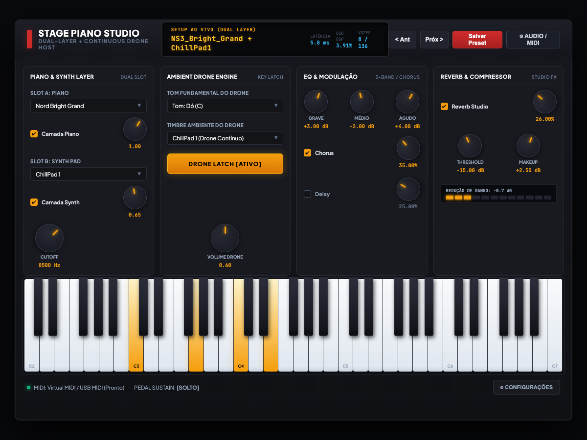

# Stage Piano Studio

Um host de instrumentos standalone, leve e de baixíssima latência, desenvolvido em C++17 e JUCE 8 para tecladistas e músicos ao vivo. Combina uma camada de piano acústico/elétrico, uma camada de sintetizador/pad atmosférico e um motor de drone harmônico infinito com um rack completo de efeitos de estúdio.

Multiplataforma com suporte nativo para **macOS**, **Windows** e **Linux** (CoreAudio, WASAPI/ASIO, ALSA/JACK).

---



---

## 🎵 O Grande Diferencial: Motor de Drone Harmônico por Nota (Key Latch)

A maioria dos tecladistas que precisa de uma "cama" ou ambient pad contínuo ao vivo recorre a gambiarras: ou usam pedais de hardware caros no chão, ou rodam arquivos de áudio estáticos (MP3/WAV) gravados em um tom só, ou tentam segurar notas com o pedal de sustain do teclado — o que acaba embolando todos os acordes do piano quando você toca com as duas mãos.

O **Stage Piano Studio** resolve isso na raiz do DSP com um **motor de drone por nota totalmente integrado e desacoplado**:

### Como funciona na prática?

1. **Fundamental Harmônica Real (12 Tons):** Selecione diretamente a nota raiz da música (de Dó a Si: C, C#, D, D#, E, F, F#, G, G#, A, A#, B). O motor sintetiza a frequência exata da nota fundamental a partir de timbres ricos de sintetizadores analógicos, pads com shimmer ou corais atmosféricos.
2. **Independência Total do Pedal de Sustain:** O drone roda em uma trilha de voz isolada com chave *Key Latch*. Você pode tocar piano com acordes rápidos, staccatos ou arpejos soltos, pisando e soltando o pedal de sustain à vontade no **Slot A**, que o drone no **Slot B** continua soando contínuo, limpo e cristalino, sem embolar nem cortar.
3. **Loop Infinito com Crossfade de Potência Constante (*Equal-Power*):** Chega de estalos de fim de amostra ou cortes secos. O algoritmo de looping calcula janelas trigonométricas seno/cosseno nas bordas da amostra (`gainA = cos(t * π/2)`, `gainB = sin(t * π/2)`), garantindo uma sustentação infinita, sem perda de volume e 100% livre de ruídos de fase.
4. **Modulação Musical Sem Quedas (Smart Transition):** Quando a música modula de tom no meio da apresentação (ex: de Sol Maior para Dó Maior), basta alterar o tom no seletor ou avançar o preset: a nota anterior entra automaticamente em um release suave de 1,5 segundos enquanto a nova nota fundamental surge gradualmente, criando uma transição cinematográfica e orgânica para a banda.

---

## Por que este projeto existe?

Quem toca teclado ao vivo geralmente esbarra em duas dores clássicas:

1. **Hosts pesados e lentos:** Plugins e samplers gigantescos que consomem gigabytes de memória RAM, demoram minutos para abrir e adicionam complexidade desnecessária para quem só precisa de um piano de cauda com resposta dinâmica imediata somado a um pad quente.
2. **Falta de um gerador de drone contínuo integrado:** Em apresentações ao vivo, passagens de louvor e trilhas ambientais, é comum precisar de uma cama harmônica contínua (drone pad) sustentada no tom da música, sem amarrar o pedal de sustain do piano e sem precisar de pedais extras no chão.

O **Stage Piano Studio** resolve isso: carregamento instantâneo de amostras, latência de áudio abaixo de 6 ms, mixagem em tempo real de duas camadas simultâneas e um motor de drone com crossfade infinito em potência constante que nunca corta o som nem gera estalos de loop.

---

## Recursos e Funcionalidades

### 1. Arquitetura de Camada Dupla (Dual-Layer)
- **Slot A (Piano):** Pianos de cauda (Grands), pianos verticais (Uprights), pianos elétricos clássicos (Rhodes Mark I a V, Dyno), Wurlitzers, CP-80 e digitais FM estilo DX7.
- **Slot B (Synth Pad):** Pads analógicos quentes, corais vocais, texturas shimmer e leads polifônicos.
- Controle independente de volume por slot, chave liga/desliga rápida e filtro passa-baixas ressonante (*Cutoff* de até 20 kHz).

### 2. Motor de Drone Ambiente Contínuo (Key Latch)
- **Loop Infinito com Crossfade:** Algoritmo de potência constante com funções seno/cosseno nas bordas das amostras, eliminando cliques, quedas de volume ou estalos de transição.
- **Seletor Harmônico Fundamental:** Transposição instantânea da nota raiz do drone para qualquer uma das 12 tonalidades (de Dó a Si).
- **Transição Suave ao Vivo:** Ao trocar o tom da música com o drone ativo, o tom anterior faz um fade-out gradual de 1,5 segundos enquanto a nova nota cresce suavemente por baixo, mantendo a harmonia contínua.
- Volume e controle de presença dedicados.

### 3. Rack de Efeitos DSP de Estúdio
- **Equalizador de 3 Bandas:** Graves (*Low Shelf* em 80 Hz), Médios paramétricos ajustáveis (*Peaking* em 1,2 kHz com Q) e Agudos (*High Shelf* em 8 kHz) usando biquads transpostos (RBJ Forma Direta II).
- **Chorus Estéreo em Quadratura:** Modulação com 90 graus de diferença de fase entre canais para abertura e profundidade estéreo.
- **Delay Ping-Pong:** Linhas de atraso cruzadas com amortecimento de altas frequências no feedback.
- **Reverb de Estúdio:** Algoritmo de difusão de ambiente/hall com cauda natural e ajuste de mix.
- **Compressor Dinâmico de Estúdio:** Detetor de envelope suave (*soft-knee*), controle de Threshold, ganho de saída (*Makeup*) e barra com medidor de LEDs em tempo real de redução de ganho (*Gain Reduction Meter*).

### 4. Teclado Virtual & Conectividade MIDI Universal
- **Teclado Virtual de 61 Teclas:** Totalmente integrado na interface (de C2 a C7), com suporte a cliques de mouse, atalhos de computador e feedback visual luminoso das notas acionadas.
- **Reconhecimento MIDI Plug-and-Play:** Reconhece e roteia automaticamente qualquer teclado USB MIDI ou interface conectada ao sistema (Roland, Yamaha, Korg, Casio, Arturia, Novation, etc.).
- **Suporte a Pedal de Sustain:** Leitura direta de CC#64 com liberação amortecida de vozes.
- **Painel de Configurações de Áudio & MIDI:** Permite escolher drivers de baixa latência, taxa de amostragem (44.1 kHz / 48 kHz / 96 kHz) e tamanho de buffer de 64 a 512 amostras.

---

## Estrutura do Código

```
StagePianoStudio/
├── CMakeLists.txt              # Configuração CMake unificada (baixa JUCE 8 automaticamente se necessário)
├── .github/workflows/          # Pipeline CI/CD com build automático para macOS, Windows e Linux
├── engine/                     # Motor DSP e processamento de áudio (C++17 puro)
│   ├── include/
│   │   ├── Sampler.hpp         # Amostrador polifônico com multi-velocity e loop crossfade
│   │   ├── StagePianoHost.hpp  # Host central que sincroniza Slot A, Slot B, Drone e Efeitos
│   │   ├── Equalizer.hpp       # EQ biquad de 3 bandas
│   │   ├── Compressor.hpp      # Compressor dinâmico com telemetria de GR
│   │   ├── Chorus.hpp          # Chorus estéreo em quadratura
│   │   ├── Delay.hpp           # Delay ping-pong
│   │   ├── Reverb.hpp          # Reverb algorítmico de estúdio
│   │   └── TimbrePreset.hpp    # Serialização e salvamento de presets em JSON
│   └── src/
├── gui/                        # Interface gráfica nativa JUCE 8
│   ├── Source/
│   │   ├── Main.cpp            # Janela principal da aplicação
│   │   ├── MainComponent.cpp   # Layout da mesa de controle, teclado virtual e audio callback
│   │   └── StagePianoLookAndFeel.cpp # Estilização visual dark studio inspirada em racks pro
│   └── CMakeLists.txt
├── library/                    # Mapeamentos de instrumentos e biblioteca de presets
│   ├── instruments/            # Zonas de notas e camadas de velocity (JSON)
│   └── presets/                # Presets salvos de timbres combinados (JSON)
├── tools/                      # Ferramentas de suporte e engenharia reversa
│   └── nkx_extractor.cpp       # Extrator de arquivos monolíticos e decodificador WAV
├── docs/                       # Documentação e capturas de tela
│   ├── screenshot.png          # Captura oficial da interface
│   └── MIDI_SETUP.md           # Guia de configuração de teclados MIDI
└── ROADMAP.md                  # Próximas etapas do projeto (importador SF2, etc.)
```

---

## Compilação e Execução

### Pré-requisitos
- **CMake** 3.22 ou superior
- Compilador compatível com C++17:
  - **macOS:** Xcode Command Line Tools (`clang`)
  - **Windows:** Visual Studio 2022 (MSVC) ou Build Tools
  - **Linux:** GCC 11+ ou Clang 13+

### Dependências no Linux (Ubuntu / Debian)
```bash
sudo apt-get update
sudo apt-get install -y \
  libasound2-dev libjack-jackd2-dev libfreetype6-dev libfontconfig1-dev \
  libx11-dev libxinerama-dev libxrandr-dev libxcursor-dev libgl1-mesa-dev
```

### Comandos de Compilação (Todas as Plataformas)
```bash
# 1. Clonar o repositório
git clone https://github.com/lguilherme44/stage-piano-studio.git
cd stage-piano-studio

# 2. Configurar o projeto (o CMake baixa o JUCE 8.0.4 automaticamente via FetchContent)
cmake -B build -DCMAKE_BUILD_TYPE=Release

# 3. Compilar em paralelo
cmake --build build --config Release --parallel
```

O binário final será gerado em:
- **macOS:** `build/gui/StagePianoStudio_artefacts/Release/Stage Piano Studio.app`
- **Windows:** `build/gui/StagePianoStudio_artefacts/Release/Stage Piano Studio.exe`
- **Linux:** `build/gui/StagePianoStudio_artefacts/Release/Stage Piano Studio`

---

## Formato das Amostras & SF2

As definições de instrumentos utilizam arquivos JSON descritivos em `library/instruments/`:

```json
{
  "name": "Nord_Bright_Grand",
  "sample_rate": 44100,
  "channels": 2,
  "notes": {
    "60": [
      {
        "min_velocity": 1,
        "max_velocity": 64,
        "target_velocity": 32,
        "sample": "Piano_C4_pp.wav"
      },
      {
        "min_velocity": 65,
        "max_velocity": 127,
        "target_velocity": 127,
        "sample": "Piano_C4_ff.wav"
      }
    ]
  }
}
```

> **Aviso sobre amostras de áudio:** Este repositório disponibiliza o código-fonte, o motor DSP, os mapeamentos JSON de zonas de notas e as ferramentas de engenharia reversa. Por questões de direitos autorais e tamanho de armazenamento, gravações originais de áudio (.wav) **não** são distribuídas neste repositório. As gravações adquiridas legalmente devem ser colocadas no diretório local `library/samples/`. O suporte nativo para carregar arquivos de instrumentos livres **SoundFont 2 (.sf2)** está listado no [ROADMAP.md](ROADMAP.md).

---

## Licença

Este projeto é distribuído sob os termos da licença **MIT** — consulte o arquivo [LICENSE](LICENSE) para mais detalhes. As ferramentas de engenharia reversa e decodificação presentes neste repositório foram criadas exclusivamente para fins de interoperabilidade técnica, estudo de arquitetura e pesquisa acadêmica.
